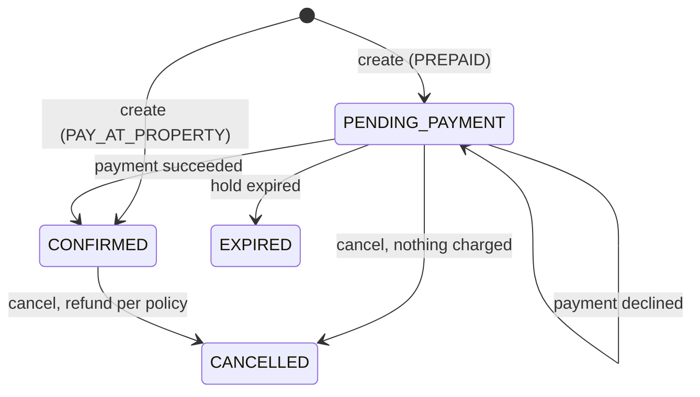

# Hotel Booking Service

This is the backend for a hotel booking platform, written for the Rupeek SDE-3 take-home "Hotel Booking System" (Question A). Guests search properties by city, dates and party size, then book a room type for a date range. They pay by card, UPI or wallet, and can cancel under a refund policy. Owners open an account and onboard one or many properties, each with room types, amenities, a pricing strategy and a cancellation policy. Inventory is safe under concurrent bookings, prices come from pluggable strategies, payments are idempotent, and the API is documented with OpenAPI.

**Stack:** Python 3.13 (container image `python:3.13-slim`), Django 5.2 LTS, Django REST Framework 3.16, drf-spectacular, PostgreSQL 18 and Redis 7. Rupeek approved Python/Django in place of the brief's Java/Spring Boot. The design uses the same seams a Spring reviewer would look for:

| Spring Boot | Here |
|---|---|
| Java `interface` for a repository or port | ABC in `<app>/interfaces/` (`repositories.py`, `ports.py`) |
| `@Service` | use-case classes in `<app>/services/` |
| JPA `@Entity` / `JpaRepository` | Django model in `<app>/models/`, plus a repository in `<app>/repositories/` that maps model to domain object |
| `@Configuration` / `@Bean` wiring | `<app>/container.py`, the composition root |
| `@RestController` | DRF `ViewSet` in `<app>/views/`, routed in `<app>/urls.py` |
| Request DTO with Bean Validation | DRF serializer in `<app>/serializers/` built from `Hotel*Field`s |
| `@Transactional` | `UnitOfWork` (`transaction.atomic()`), see `hotel_commons/db/unit_of_work.py` |
| `@ControllerAdvice` | `hotel_commons.api.exception_handler.envelope_exception_handler` |
| Servlet filter / `HandlerInterceptor` | Django middleware in `hotel_commons/middlewares/` |
| `ApplicationEventPublisher` | `EventPublisher` with an in-process bus (`hotel_commons/events/`) |
| `@Scheduled` | management commands run by the `scheduler` container |
| Flyway / Liquibase | Django migrations |
| springdoc-openapi | drf-spectacular |
| Spring profile | `ENVIRONMENT` (`local` or `production`, which is the default) |
| JUnit + Mockito | pytest + pytest-django, with in-memory fakes in `<app>/tests/fakes.py` |

Design documents: [docs/HLD.md](docs/HLD.md) (architecture, flows, decisions) and [docs/LLD.md](docs/LLD.md) (classes, tables, endpoints, status codes, test plan).

## Contents

1. [Quick start](#quick-start)
2. [API walkthrough with curl](#api-walkthrough-with-curl)
3. [Running tests](#running-tests)
4. [Architecture in brief](#architecture-in-brief)
5. [Key design decisions](#key-design-decisions)
6. [Assumptions](#assumptions)
7. [Beyond the brief: platform features](#beyond-the-brief-platform-features)
8. [Mock payment gateway](#mock-payment-gateway)
9. [Dev-only secrets](#dev-only-secrets)
10. [What I would do with more time](#what-i-would-do-with-more-time)

## Quick start

You need Docker with Compose v2. The curl walkthrough also uses `jq`.

```sh
docker compose up --build
```

To start the stack in the background and wait until it is healthy, run `./local_run.sh` instead. It calls `docker compose up --build -d --wait`.

Compose starts four services:

| Service | What it runs |
|---|---|
| `postgres` | `postgres:18`, on port 5432, with database, user and password all `hotel` |
| `redis` | `redis:7-alpine`, on port 6379 |
| `app` | `docker/entrypoint.sh`: `migrate`, then `seed_demo`, then gunicorn on port 8000 |
| `scheduler` | `docker/scheduler.sh`: `expire_pending_bookings` and `extend_inventory_horizon` every 60 s |

Migrations and the demo data load automatically, so search works as soon as the app reports healthy. `seed_demo` is idempotent. It creates:

| Owner user | Account | Properties |
|---|---|---|
| `owner-chain` | Coastal & Garden Hotels | Sea Breeze Resort, Goa (RESORT, WEEKEND pricing, MODERATE policy): Deluxe Sea View ×10 at ₹4800, Family Suite ×4 at ₹8500. Garden City Business Hotel, Bengaluru (HOTEL, DYNAMIC pricing, FLEXIBLE policy): Standard King ×20 at ₹3200, Executive Twin ×8 at ₹4500 |
| `owner-solo` | Anjuna Villa Stays | Casa Anjuna Villa, Goa (VILLA, STANDARD pricing, NON_REFUNDABLE): Entire Villa ×1 at ₹15000 |

Useful URLs:

| URL | |
|---|---|
| http://localhost:8000/hotel/v1/docs | Swagger UI |
| http://localhost:8000/hotel/v1/schema | OpenAPI 3 schema |
| http://localhost:8000/hotel/v1/health | Postgres and Redis status |

Routes have no trailing slash. Stop the stack with `docker compose down`, or run `docker compose down -v` to also delete the database volume.

### Getting a token

Every endpoint except health, docs, schema, the public key, search, property details and amenities needs a bearer JWT. When `ENVIRONMENT=local` (which `.env.example` sets), you can get one from either of these:

```sh
# HTTP: this route exists only when ENVIRONMENT=local
curl -s -X POST http://localhost:8000/hotel/v1/dev/tokens \
  -H 'Content-Type: application/json' \
  -d '{"user_id": "guest-1", "roles": ["GUEST"]}'
# -> {"status": 2100000, "message": "Success", "data": {"token": "eyJ...", "expires_in": 3600}, "request_id": "..."}

# Management command: works in any environment that has the signing key
docker compose exec app python manage.py mint_token --sub guest-1 --roles GUEST
docker compose exec app python manage.py mint_token --sub owner-chain --roles OWNER --ttl 7200
```

The roles are `GUEST`, `OWNER` and `ADMIN`, and one token may carry several of them (`--roles GUEST,OWNER`). `/dev/tokens` issues ADMIN tokens only when `DEV_TOKENS_ALLOW_ADMIN=true`, which `.env.example` sets for the demo. In Swagger UI, click **Authorize** and paste the token.

### Response envelope

Every response, including errors, uses the same envelope with the real HTTP status:

```json
{"status": 2100000, "message": "Success", "data": {}, "request_id": "..."}
{"status": 2105002, "message": "Cannot cancel a booking that is CANCELLED", "errors": null, "data": null, "request_id": "..."}
```

`status` is a `21MMEEE` code: service `21`, then a module (`00` common, `01` catalog, `02` inventory, `03` pricing, `04` discovery, `05` booking, `06` payment), then an error number. Each app keeps its codes in `<app>/status_code.py`.

On the wire, amounts are rupee strings with two decimals (`"7000.00"`) and a sibling `"currency": "INR"`. Enums are member names (`"PREPAID"`, `"CONFIRMED"`). Dates use `YYYY-MM-DD`, times use `HH:MM`, and instants are UTC ISO-8601.

## API walkthrough with curl

These steps run the whole lifecycle on a fresh property: owner account, then onboard, search, book, pay, a declined payment, cancel, and search again. Paste them into one shell session, since later steps reuse the variables.

The stay dates are fixed at 2026-12-15 to 2026-12-17 (Tuesday and Wednesday nights). A stay must start between today and 365 days ahead, so move the dates if that window has passed. Owner contact emails are unique, so a second run against the same database needs a different `contact_email` (or run `docker compose down -v` first).

**0. Setup and tokens.**

```sh
API=http://localhost:8000/hotel/v1
JSON='Content-Type: application/json'
token() {
  curl -s -X POST "$API/dev/tokens" -H "$JSON" \
    -d "{\"user_id\": \"$1\", \"roles\": [\"$2\"]}" | jq -r .data.token
}
OWNER=$(token owner-demo OWNER)
GUEST=$(token guest-1 GUEST)
GUEST2=$(token guest-2 GUEST)
```

**1. Open an owner account** (OWNER or ADMIN). The caller becomes the account's owner.

```sh
R=$(curl -s -X POST "$API/catalog/owner-accounts" -H "Authorization: Bearer $OWNER" -H "$JSON" -d '{
  "display_name": "Pink City Stays",
  "contact_email": "owner.demo@example.com",
  "contact_phone": "9876500010"
}')
echo "$R" | jq .data
ACCOUNT_ID=$(echo "$R" | jq -r .data.account_id)
```

```json
{"account_id": "019a...", "display_name": "Pink City Stays", "owner_user_id": "owner-demo",
 "contact_email": "owner.demo@example.com", "contact_phone": "9876500010", "created_at": "2026-10-26T..."}
```

The owner and ADMIN see the contact details in full. Anyone else sees them masked.

**2. Onboard a property** with its room types (HTTP 201). The response includes inventory for the next 365 nights, and a search listing is created in the same transaction.

```sh
R=$(curl -s -X POST "$API/catalog/owner-accounts/$ACCOUNT_ID/properties" \
  -H "Authorization: Bearer $OWNER" -H "$JSON" -d '{
  "name": "Amber Courtyard Hotel",
  "description": "Heritage hotel near the old city.",
  "property_type": "HOTEL",
  "star_rating": 4,
  "address": {"line1": "12 MI Road", "locality": "C-Scheme", "city": "Jaipur",
              "state": "Rajasthan", "postal_code": "302001"},
  "amenities": ["WIFI", "POOL", "BREAKFAST"],
  "pricing_strategy": "STANDARD",
  "cancellation_policy": "MODERATE",
  "check_in_time": "14:00",
  "check_out_time": "11:00",
  "room_types": [
    {"name": "Deluxe Double", "max_occupancy": 2, "total_rooms": 5,
     "base_price": "3500.00", "amenities": ["AIR_CONDITIONING", "TV"]}
  ]
}')
echo "$R" | jq .data
PROPERTY_ID=$(echo "$R" | jq -r .data.property_id)
ROOM_TYPE_ID=$(echo "$R" | jq -r '.data.room_types[0].room_type_id')
```

`country` defaults to `"IN"`. `pricing_strategy`, `cancellation_policy` and the check-in and check-out times are optional (defaults `STANDARD`, `MODERATE`, `14:00` and `11:00`). `GET $API/catalog/amenities` lists the valid amenity codes. A HOTEL or RESORT must have a `star_rating`, and a VILLA must be one room type with `total_rooms: 1` (422 otherwise).

**3. Search** (public).

```sh
curl -s "$API/discovery/search?city=Jaipur&check_in=2026-12-15&check_out=2026-12-17&guests=2" | jq .data
```

```json
{"items": [{"property_id": "019a...", "name": "Amber Courtyard Hotel", "property_type": "HOTEL", "star_rating": 4,
            "city": "Jaipur", "locality": "C-Scheme", "amenities": ["BREAKFAST", "POOL", "WIFI"],
            "lowest_nightly_price": "3500.00", "currency": "INR",
            "offers": [{"room_type_id": "019a...", "room_type": "Deluxe Double", "max_occupancy": 2,
                        "available_rooms": 5, "pricing_strategy": "STANDARD",
                        "nightly_rates": [{"date": "2026-12-15", "price": "3500.00"},
                                          {"date": "2026-12-16", "price": "3500.00"}],
                        "total": "7000.00", "average_nightly": "3500.00", "currency": "INR"}]}],
 "page": 1, "page_size": 20, "total": 1}
```

`city`, `check_in`, `check_out` and `guests` are required. The optional filters are `rooms`, `locality`, `min_price` and `max_price` (average nightly price, in rupees), `amenities=WIFI,POOL` (all must match), `min_rating`, `property_types=HOTEL,RESORT`, `sort=price_asc|price_desc|rating_desc`, `page` and `page_size` (at most 50). Try the seeded data with `city=Goa` (WEEKEND pricing shows on Friday and Saturday nights) or `city=Bengaluru` (DYNAMIC).

**4. Book** (GUEST or ADMIN). A `PREPAID` booking holds the rooms for 15 minutes as `PENDING_PAYMENT` (HTTP 201). `Idempotency-Key` is optional here, and a retry with the same key returns the first response.

```sh
R=$(curl -s -X POST "$API/bookings" -H "Authorization: Bearer $GUEST" -H "$JSON" \
  -H 'Idempotency-Key: book-demo-0001' -d @- <<EOF
{"room_type_id": "$ROOM_TYPE_ID", "check_in": "2026-12-15", "check_out": "2026-12-17",
 "rooms": 1, "guests": 2, "booking_type": "PREPAID",
 "guest_name": "Rahul Sharma", "guest_email": "rahul@example.com", "guest_phone": "9876543210"}
EOF
)
echo "$R" | jq .data
BOOKING_ID=$(echo "$R" | jq -r .data.booking_id)
```

```json
{"booking_id": "019a...", "status": "PENDING_PAYMENT", "booking_type": "PREPAID",
 "property_id": "019a...", "room_type_id": "019a...", "check_in": "2026-12-15", "check_out": "2026-12-17",
 "nights": 2, "rooms": 1, "guests": 2, "total": "7000.00", "currency": "INR",
 "nightly_rates": [{"date": "2026-12-15", "price": "3500.00"}, {"date": "2026-12-16", "price": "3500.00"}],
 "pricing_strategy": "STANDARD", "cancellation_policy": "MODERATE",
 "hold_expires_at": "2026-10-26T...Z", "payment_id": null,
 "refund": {"amount": null, "percent": null, "status": "NONE"},
 "guest_name": "Rahul Sharma", "guest_email": "rahul@example.com", "guest_phone": "9876543210",
 "last_payment_failure": null, "created_at": "...", "confirmed_at": null, "cancelled_at": null, "expired_at": null}
```

The price and the cancellation policy are fixed at booking time. With `"booking_type": "PAY_AT_PROPERTY"`, the booking is `CONFIRMED` at once and has no hold expiry.

**5. Pay** (GUEST or ADMIN; the booking must be the caller's own). `Idempotency-Key` is **required**.

```sh
PAY_CARD='{"method": "CARD", "card": {"card_number": "4242424242424242", "expiry_month": 12,
           "expiry_year": 2030, "cvv": "123", "holder_name": "Rahul Sharma"}}'
curl -s -X POST "$API/bookings/$BOOKING_ID/payments" -H "Authorization: Bearer $GUEST" -H "$JSON" \
  -H 'Idempotency-Key: pay-demo-0001' -d "$PAY_CARD" | jq '{status, message, booking: .data.booking.status, payment: .data.payment}'
```

```json
{"status": 2100000, "message": "Success", "booking": "CONFIRMED",
 "payment": {"payment_id": "019a...", "status": "SUCCEEDED", "instrument": "VISA •••• 4242",
             "failure_code": null, "failure_message": null}}
```

If you send the same request with the same key again, nothing is charged. You get the stored response back with the header `Idempotent-Replayed: true`:

```sh
curl -s -D - -o /dev/null -X POST "$API/bookings/$BOOKING_ID/payments" -H "Authorization: Bearer $GUEST" \
  -H "$JSON" -H 'Idempotency-Key: pay-demo-0001' -d "$PAY_CARD" | grep -i idempotent-replayed
```

Reusing the key with a different body gets 422. A request that arrives while the first one with that key is still running gets 409. UPI and wallet payments look like `{"method": "UPI", "upi": {"vpa": "rahul@okaxis"}}` and `{"method": "WALLET", "wallet": {"provider": "PAYTM", "phone": "9876543210"}}`.

**6. A declined card.** Make a second booking and pay with `4000000000000002`. The gateway declines it, and the API answers **HTTP 402** with the booking still `PENDING_PAYMENT`, so the guest can retry with another method and a new key until the hold expires.

```sh
R=$(curl -s -X POST "$API/bookings" -H "Authorization: Bearer $GUEST" -H "$JSON" \
  -H 'Idempotency-Key: book-demo-0002' -d @- <<EOF
{"room_type_id": "$ROOM_TYPE_ID", "check_in": "2026-12-15", "check_out": "2026-12-17",
 "guests": 2, "guest_name": "Rahul Sharma", "guest_email": "rahul@example.com", "guest_phone": "9876543210"}
EOF
)
BOOKING2_ID=$(echo "$R" | jq -r .data.booking_id)

curl -s -w '\nHTTP %{http_code}\n' -X POST "$API/bookings/$BOOKING2_ID/payments" \
  -H "Authorization: Bearer $GUEST" -H "$JSON" -H 'Idempotency-Key: pay-demo-0002' -d '{
  "method": "CARD", "card": {"card_number": "4000000000000002", "expiry_month": 12,
  "expiry_year": 2030, "cvv": "123", "holder_name": "Rahul Sharma"}}'
```

```json
{"status": 2105004, "message": "Payment declined: The card was declined by the issuer",
 "data": {"booking": {"booking_id": "019a...", "status": "PENDING_PAYMENT", "last_payment_failure": "card_declined", "...": "..."},
          "payment": {"payment_id": "019a...", "status": "FAILED", "instrument": "VISA •••• 0002",
                      "failure_code": "card_declined", "failure_message": "The card was declined by the issuer"}},
 "request_id": "..."}
HTTP 402
```

**7. Access rules.** The owner can list the bookings at their property, with the guest's details masked. Another guest gets 404 for a booking that is not theirs, so the API does not even confirm that the booking exists.

```sh
curl -s "$API/bookings?property_id=$PROPERTY_ID" -H "Authorization: Bearer $OWNER" \
  | jq '.data.items[] | {status, guest_name, guest_email, guest_phone}'
# one line per booking, e.g.
# {"status": "CONFIRMED", "guest_name": "R**** S*****", "guest_email": "r****@example.com", "guest_phone": "******3210"}
# {"status": "PENDING_PAYMENT", "guest_name": "R**** S*****", ...}

curl -s -w '\nHTTP %{http_code}\n' "$API/bookings/$BOOKING_ID" -H "Authorization: Bearer $GUEST2"
# HTTP 404
```

**8. Cancel.** The refund follows the policy snapshotted on the booking. MODERATE refunds 100% when the guest cancels at least 120 hours before check-in, so the first booking gets everything back. Cancelling the unpaid second booking refunds nothing and releases its hold.

```sh
curl -s -X POST "$API/bookings/$BOOKING_ID/cancel" -H "Authorization: Bearer $GUEST" -H "$JSON" \
  -d '{"reason": "plans changed"}' | jq '.data | {status, refund, cancelled_at}'
# {"status": "CANCELLED", "refund": {"amount": "7000.00", "percent": "100.00", "status": "REFUNDED"}, "cancelled_at": "..."}

curl -s -X POST "$API/bookings/$BOOKING2_ID/cancel" -H "Authorization: Bearer $GUEST" -H "$JSON" \
  -d '{}' | jq '.data | {status, refund}'
# {"status": "CANCELLED", "refund": {"amount": "0.00", "percent": "0.00", "status": "NONE"}}

# Cancelling again is an invalid transition: HTTP 409, status 2105002
curl -s -X POST "$API/bookings/$BOOKING_ID/cancel" -H "Authorization: Bearer $GUEST" -H "$JSON" -d '{}' | jq '{status, message}'
```

**9. Search again.** Both holds are released, so all five rooms are available again.

```sh
curl -s "$API/discovery/search?city=Jaipur&check_in=2026-12-15&check_out=2026-12-17&guests=2" \
  | jq '.data.items[0].offers[0].available_rooms'
# 5
```

An unpaid booking that is neither paid nor cancelled becomes `EXPIRED` after `BOOKING_HOLD_TTL_SECONDS` (900 by default). This happens when the scheduler's next run picks it up, or right away if someone tries to pay for it (409 `BOOKING_EXPIRED`). Either way, its rooms are released.

### Endpoints

All paths are under `/hotel/v1`.

| Method and path | Roles | Notes |
|---|---|---|
| `GET /health` | public | `{database, redis}`; 503 if the database is down |
| `GET /security/public-key` | public | RSA key for API payload encryption |
| `POST /dev/tokens` | public | only when `ENVIRONMENT=local` |
| `GET /catalog/amenities` | public | |
| `POST /catalog/owner-accounts` | OWNER, ADMIN | |
| `GET, POST /catalog/owner-accounts/{account_id}/properties` | OWNER, ADMIN | the caller's own account only |
| `GET /catalog/properties/{property_id}` | public | |
| `POST /catalog/properties/{property_id}/room-types` | OWNER, ADMIN | the caller's own property only |
| `GET /discovery/search` | public | |
| `POST /bookings` | GUEST, ADMIN | `Idempotency-Key` optional; ADMIN may set `on_behalf_of_user_id` |
| `GET /bookings` | GUEST, OWNER, ADMIN | guests see their own; owners must pass `property_id`; admins pass `property_id` or `guest_id` |
| `GET /bookings/{booking_id}` | GUEST, OWNER, ADMIN | the booking's guest, or the property's owner |
| `POST /bookings/{booking_id}/payments` | GUEST, ADMIN | the booking's guest; `Idempotency-Key` required; 200, 402 or 409 |
| `POST /bookings/{booking_id}/cancel` | GUEST, ADMIN | the booking's guest; `Idempotency-Key` optional |
| `GET /payments/{payment_id}` | GUEST, ADMIN | the paying guest |
| `GET /schema`, `GET /docs` | public | OpenAPI 3 and Swagger UI |

## Running tests

The tests run on the host and use a local virtualenv. The container image is Python 3.13. The host venv also works on 3.12.

```sh
python3.13 -m venv .venv
.venv/bin/pip install -r requirements-dev.txt
```

| Kind | Needs | Examples |
|---|---|---|
| Unit: domain, services against in-memory repositories and fakes, the shared library | nothing (Redis is always `fakeredis`) | `.venv/bin/pytest libs/hotel-commons/tests pricing booking/tests/test_state_machine.py booking/tests/test_booking_services.py` |
| DB: API and repository tests (`@pytest.mark.django_db`) | Postgres from docker compose | `./run-tests.sh catalog` |
| Integration: end-to-end flow and concurrency races (`-m integration`) | Postgres from docker compose | `./run-tests.sh -m integration` |

`./run-tests.sh` runs `docker compose up -d --wait postgres redis` and then `.venv/bin/pytest -q`, passing along any extra arguments:

```sh
./run-tests.sh                        # the whole suite
./run-tests.sh -m "not integration"   # skip the end-to-end and concurrency tests
./run-tests.sh booking                # one app
```

`pytest.ini` points at `hotel_booking_service.test_settings`. That module uses fixed test-only keys, forces `REDIS_URL=fakeredis://`, and connects to Postgres on `localhost:5432` with user and password `hotel`. pytest-django creates its own test database there, so the data of a running stack is not touched. The concurrency tests race 10 threads for the last room against real Postgres and assert exactly one winner and `reserved_rooms == 1`. They also race overlapping stays in both orders to show there is no deadlock.

## Architecture in brief

The service is a **modular monolith**: one Django project and one deployable, split into six apps, one per bounded context. Inside each app the code is layered hexagonally. The domain is pure Python, ports are ABCs, use cases live in services, and adapters handle the ORM, the gateway and calls to other apps. See [HLD §3](docs/HLD.md#3-architecture) for diagrams.

| App | Responsibility | Public surface (`<app>/public/`) |
|---|---|---|
| `catalog` | owner accounts, properties, room types, amenities, commercial settings | `CatalogAPI`, events `PropertyOnboarded` and `RoomTypeAdded`, enums |
| `inventory` | per-night counters per room type, holds | `InventoryAPI`: provision, hold, confirm, release, availability, occupancy |
| `pricing` | nightly rates through pluggable strategies | `PricingAPI`: quote, quote_many |
| `discovery` | search read model and filter pipeline | HTTP only; projects catalog events into `listing` |
| `booking` | booking aggregate, lifecycle, booking types, cancellation policies; runs pay and cancel | events only |
| `payment` | payments, refunds, method strategies, gateway | `PaymentAPI`: charge, refund, lookups |
| `hotel_commons` (`libs/hotel-commons`) | shared library, nothing hotel-specific: settings, middlewares, model bases, security, rate limiting, idempotency, events, money | installed with `pip install -e` |

The design follows these rules:

- **Boundaries.** An app imports another app only through its `public` package (facade, DTOs, events, enums). `booking` reaches catalog, pricing, inventory and payment through adapters in `booking/adapters/` that implement its own ports. The dependency graph is acyclic.
- **Wiring.** `container.py` is the only place that chooses implementations. Unit tests build the same services from in-memory repositories and fakes.
- **One database, one schema per context.** PostgreSQL holds the schemas `catalog`, `inventory`, `discovery`, `booking` and `payment` (pricing has no tables). Everything goes through one connection, so book → hold and pay → charge → confirm stay single ACID transactions. There are no foreign keys across schemas; references between contexts are UUIDv7 columns. This lets an app move to its own service and database later ([HLD §14](docs/HLD.md#14-path-to-microservices)).

```text
hotel-booking-service/
├── hotel_booking_service/    # project: settings.py, test_settings.py, urls.py (all routes), wsgi/asgi
├── catalog/  inventory/  pricing/  discovery/  booking/  payment/
├── libs/hotel-commons/       # shared library: hotel_commons/ + tests/
├── tests/                    # cross-app integration tests (end-to-end flow, concurrency)
├── scripts/encrypted_request.py
├── docker/                   # entrypoint.sh (app), scheduler.sh
├── secrets/dev/              # DEV-ONLY RSA key, mounted read-only into the containers
├── docs/                     # HLD.md, LLD.md
├── Dockerfile  docker-compose.yml  local_run.sh  run-tests.sh
├── requirements.txt  requirements-dev.txt  pytest.ini  conftest.py
└── .env.example              # DEV-ONLY settings used by docker compose
```

One app, `booking`, in full (other apps leave out folders they do not need):

```text
booking/
├── domain/              # pure Python: Booking aggregate, state_machine.py, booking_types.py, cancellation.py
├── interfaces/          # ABCs: repositories.py, ports.py (CatalogPort, PricingPort, InventoryPort, PaymentPort)
├── services/            # use cases: create_booking.py, pay_booking.py, cancel_booking.py, expire_bookings.py
├── adapters/            # ports implemented over catalog/pricing/inventory/payment public APIs
├── repositories/        # Django ORM repositories + model <-> domain mappers
├── models/              # CommonBooking / Booking / BookingLog
├── serializers/  views/  urls.py
├── public/              # events.py
├── management/commands/ # expire_pending_bookings
├── migrations/
├── tests/               # fakes.py + unit, service and API tests
├── container.py  enums.py  constants.py  status_code.py  apps.py
```

## Key design decisions

### Brief requirements mapped to the design

| Brief requirement | Where | Mechanism |
|---|---|---|
| Search by city or locality, dates, guests | `discovery` | Listing read model filtered, then live availability (`inventory`) and quotes (`pricing`) |
| Add filters without reworking search | `discovery/domain/filters.py` | `SearchFilter` interface + `@register_filter` |
| Show only available properties | `inventory` | One aggregate SQL over per-night rows for all candidate room types |
| Onboard a property with room types, amenities, pricing | `catalog` | `PropertyOnboardingService` |
| Standalone vs multi-property owners | `catalog/domain` | `OwnerAccount` 1–N `Property`; standalone is an account with one property, on the same code path |
| Book a room type; no double booking | `booking` + `inventory` | Ordered row locks + DB `CHECK` on per-night counters |
| Clear booking lifecycle | `booking/domain/state_machine.py` | Transition table; an invalid transition is 409 |
| Multiple payment methods | `payment/domain/methods.py` | `PaymentMethodHandler` strategies: CARD, UPI, WALLET |
| Payment outcome drives booking state | `booking/services/pay_booking.py` | Success → `CONFIRMED`; decline → stays `PENDING_PAYMENT` (402) |
| Pluggable cancellation and refunds | `booking/domain/cancellation.py` | `CancellationPolicy` interface; tiered policies chosen per property |
| Release inventory on cancel | `inventory` | Idempotent `release_hold` |
| Repositories behind interfaces | every app | `interfaces/` ABCs; Django and in-memory implementations |
| Mock third parties | `payment/adapters/mock_gateway.py` | `PaymentGateway` interface, `MockPaymentGateway` |
| Bonus: concurrent bookings | `inventory`, `booking` | See [Concurrency](#concurrency) |
| Bonus: pluggable and dynamic pricing | `pricing` | `PricingStrategy` registry: STANDARD, WEEKEND (Fri/Sat ×1.20), DYNAMIC (weekend factor × occupancy surge: ≥70% ×1.10, ≥90% ×1.25) |
| Bonus: payment idempotency | `hotel_commons/idempotency` + `payment` | `Idempotency-Key` in Redis + unique key in Postgres + idempotent gateway call |
| Bonus: OpenAPI | project | drf-spectacular at `/hotel/v1/docs` |

### Concurrency

Inventory is a row per room type per night: `inventory.room_night(room_type_id, stay_date, total_rooms, reserved_rooms)` with `CHECK (0 <= reserved_rooms AND reserved_rooms <= total_rooms)`.

- **Holding rooms.** A hold runs `SELECT … FOR UPDATE` on the stay's nights **in date order**, checks availability, increments `reserved_rooms` and inserts the hold, all in one transaction. Locking in a fixed order means overlapping stays cannot deadlock. The `CHECK` makes overselling impossible even if application code is wrong.
- **Booking transitions.** Pay, cancel and expire each lock the booking row first. A payment racing the expiry job, or a double-clicked cancel, is therefore decided under the lock. "Expired" means `now >= hold_expires_at` in code and in SQL alike.
- **Expiry job.** The job handles one booking per transaction with `FOR UPDATE SKIP LOCKED`, so workers never block each other or new bookings.
- **Fail fast.** `lock_timeout=2s` and `statement_timeout=5s` turn contention into a quick error instead of a queue.
- **Missing rows.** A hold first creates any missing night rows (`ON CONFLICT DO NOTHING`), and the scheduler keeps the 365-day horizon provisioned.
- **Committed outcomes.** A declined payment or an expired hold is committed first, and the service then *returns* that outcome (402 or 409 with `data`). The service never raises after a state change, so the change is never rolled back.
- **Payment idempotency has four layers.** (1) Redis `SET NX` on `Idempotency-Key`, scoped per user and endpoint and checked against an HMAC fingerprint of the request. (2) A durable replay check that finds an earlier charge by its key, so a retry after Redis forgets the key still returns the original 200. (3) A unique `idempotency_key` on payment and refund rows. (4) The same key passed to the gateway.

The rejected alternatives were per-room exclusion constraints (guests book room types, not room numbers), optimistic version columns (clients retry on popular dates) and Redis locks (a second source of truth). See [HLD §9](docs/HLD.md#9-concurrency-and-consistency).

### State machines



Booking transitions live in one table, `TRANSITIONS` in `booking/domain/state_machine.py`. Any pair not in the table raises 409 `INVALID_STATE_TRANSITION`. Payments go `INITIATED → SUCCEEDED | FAILED`, then `SUCCEEDED → PARTIALLY_REFUNDED | REFUNDED`. Inventory holds go `HELD → CONFIRMED`, and `HELD | CONFIRMED → RELEASED`.

### Audit trail: the log-model strategy and `AddCommonField`

- **Common fields.** Every model inherits `AddCommonField`: `status` (1 active, 0 inactive, for soft delete), `creation_date`, `creation_by`, `updation_date` and `updation_by`. They are stamped from the caller's principal, read from a `ContextVar`, on every write path: `save()`, queryset `update()`, `bulk_create()` and `bulk_update()`. Outside a request they fall back to `system`. `objects_active` returns only active rows.
- **Triad.** Audited entities use a `CommonX` (abstract business columns), `X` (live) and `XLog` (history) triad, registered with `CustomUpdateManager.set_logModel("app.XLog", "app.X")`.
- **Snapshots.** Every write appends a full snapshot to `XLog` in the same transaction, with the actor and request id. `log` uses `on_delete=RESTRICT`.
- **Coverage.** Logs are kept for OwnerAccount, Property, RoomType, InventoryHold, Booking, Payment and Refund. RoomNight (a high-churn counter), Listing (a rebuildable projection) and Amenity (seed data) have none.

### PII encryption at rest

- **What is encrypted.** Guest name, email and phone, owner contact details, and UPI VPA or wallet phone are stored as AES-256-GCM ciphertext (`ENC_<key-id>:<base64>`) by `EncryptedTextField`, which covers every write path, log tables included.
- **Column binding.** Associated data (`<PI type>|<column>`) ties each ciphertext to its column. The key id in the prefix allows key rotation.
- **Lookups.** Equality lookups use a keyed HMAC blind index (`contact_email_hash`, which is unique). Owner-facing screens read `masked_*` companion columns without decrypting.
- **Cards.** Card number and CVV are never stored: only the brand and last four digits survive (`VISA •••• 4242`).
- **Logs.** Services log ids only. Commands and DTOs hide PII from `repr`, and a logging filter redacts emails, phone numbers and card numbers as a safety net.
- **Stored replies.** Idempotent responses stored in Redis are encrypted with the same cipher.

### Money and enums

- **Money is integer paisa end to end.** `Money(paisa: int)` in the domain, `BIGINT *_paisa` columns, no floats, and `ROUND_HALF_UP` to a whole paisa. Conversion happens only at the API edge.
- **Enums are `SMALLINT` in the database** through the model `EnumField`. They travel as member names, so the integers never leak and can be relabelled safely.
- **Custom serializer fields.** All serializers use the `Hotel*Field` classes in `hotel_commons/serializers/fields.py`, never bare DRF fields:
  - `HotelAmountField` turns `"4800.50"` into `480050` on input and `480050` into `"4800.50"` on output. It rejects `"0.105"`, negatives, `NaN` and float artefacts.
  - `HotelEnumField` accepts and returns enum names.
  - The fields also carry field-level access rules: `restrict_roles`, `read_roles`, `subject_attr` and `mask_as`.

### Extensibility

| To add | Change | Untouched |
|---|---|---|
| A search filter | A `SearchFilter` subclass with `@register_filter` in `discovery/domain/filters.py`: an `INDEX` filter returns a `Predicate` on the listing; an `OFFER` filter implements `matches()` on a priced offer. A filter with a new query parameter also adds it to `SearchQuerySerializer` and `SearchCriteria` | `SearchService`, the view, the repository |
| A payment method | A `PaymentMethod` member (`payment/public/enums.py`), a `PaymentMethodHandler` in `payment/domain/methods.py` registered in `payment/container.py`, and a details serializer in `BookingPaymentSerializer` | `ChargeService`, `PayBookingService` |
| A pricing strategy | A `PricingStrategyCode` member (`catalog/public/enums.py`) and a `PricingStrategy` in `pricing/domain/strategies.py`, registered in `build_default_registry()` | `PricingService`, discovery, booking |
| A cancellation policy | A `CancellationPolicyCode` member and an entry in `DEFAULT_CANCELLATION_POLICIES` (a new `TieredCancellationPolicy` tier table or a new `CancellationPolicy` class) in `booking/domain/cancellation.py` | `CancelBookingService` |
| A booking type | A `BookingType` member (`booking/enums.py`) and a `BookingTypePolicy` in `booking/domain/booking_types.py` (initial status, whether online payment is needed, hold expiry) | the booking services |
| A property type | A `PropertyType` member and, if it has its own rules, a `PropertyTypeRule` in `catalog/domain/property_rules.py` | the onboarding service |
| A real payment gateway | A `PaymentGateway` adapter (`payment/interfaces/gateway.py`) wired in `payment/container.py` | payment domain and services |

## Assumptions

| # | Assumption |
|---|---|
| A1 | Inventory is sold per **room type per night**. Rooms inside a room type are interchangeable; a physical room number is assigned at check-in, which is out of scope. |
| A2 | A stay is `[check_in, check_out)`: the check-out night is not charged. Stays are 1–30 nights and may start from today up to 365 days ahead. |
| A3 | One booking is one room type × `rooms` identical rooms, with `guests ≤ rooms × max_occupancy`. |
| A4 | Single currency (INR). Prices are per room per night, taxes included. |
| A5 | A prepaid booking holds inventory for 15 minutes (configurable). Unpaid holds expire and release inventory. |
| A6 | A declined payment leaves the booking `PENDING_PAYMENT`, so the guest can retry with another method until the hold expires. |
| A7 | Refunds follow the cancellation policy **snapshotted at booking time**; later property edits never change an existing booking's terms. |
| A8 | Every property belongs to exactly one owner account, and every owner account has one owning user. An independent hotelier is an account with one property, on the same code path as a chain. |
| A9 | Callers present a signed JWT carrying `sub` and `roles` (GUEST, OWNER, ADMIN). Search, property details and amenities are public. |

These are the cancellation tiers, measured against check-in at the property's check-in time (Asia/Kolkata). A tier boundary counts as inside the tier, so cancelling exactly 24 hours before check-in still earns the 24-hour tier. Cancelling after check-in is refused with 422.

| Policy | Refund |
|---|---|
| FLEXIBLE | 100% at ≥ 24 h before check-in, else 50% |
| MODERATE | 100% at ≥ 120 h, 50% at ≥ 24 h, else 0% |
| STRICT | 50% at ≥ 168 h, else 0% |
| NON_REFUNDABLE | 0% |

## Beyond the brief: platform features

Brief §8 lists authentication as out of scope. Identity here is therefore deliberately minimal: there is no login or user management, only signed tokens minted for the demo. The features below were requested extras, built into `hotel_commons` so that any future service gets them too. They run in this order: request context, then payload decryption, JWT authentication, rate limit, role check, IDOR check, idempotency and field-level security, and finally the use case.

| Feature | What it does | Toggle |
|---|---|---|
| **JWT identity and roles** | HS256 tokens with `iss`, `aud`, `exp`, `nbf`, `sub` and `roles`, verified by middleware. The algorithm is pinned, every claim is required, the key must be at least 32 bytes and the `sub` format is checked. A `TokenVerifier` protocol leaves room for RS256/JWKS behind a gateway. Roles are checked per action. | always on; `/dev/tokens` only when `ENVIRONMENT=local` |
| **IDOR protection** | Views declare `idor_rules` per action: the resource, where its id comes from, and which relationship counts (`guest` or `owner`). Ownership is read from Postgres through resolvers each app registers. A failed check returns 404. A user who is both guest and owner can view a stranger's booking at their own property but cannot pay for or cancel it. | always on |
| **Field-level security** | `on_behalf_of_user_id` and `guest_id` are ADMIN-only on write (403 for anyone else). Guest PII is plain for the guest and ADMIN and masked for owners. `gateway_txn_id` is shown only to ADMIN. | always on |
| **API payload encryption** | Hybrid RSA-OAEP-256 (3072-bit) and AES-256-GCM. The client encrypts the body with a fresh AES key and wraps that key with the server's public key (`X-Encrypted-Key`), adding `X-Payload-Encryption: v1` and `X-Payload-Timestamp`. The associated data binds method, path, timestamp and direction. Each wrapped key is accepted once (a Redis replay guard), and the response is encrypted with the same AES key. Health, docs, schema, public key and dev tokens always bypass it. | `API_ENCRYPTION_MODE=off \| optional \| enforced` (`optional` in `.env.example`: plaintext and encrypted both work) |
| **Rate limiting** | A sliding-window log in Redis, run as one atomic Lua script on Redis server time and keyed by user, or by client IP when anonymous. Per-scope limits per minute: default 120, search 60, catalog writes 30, booking writes 20, payments 10, encrypted requests 300 per IP. Over the limit it returns 429 with `Retry-After` and `X-RateLimit-*` headers. If Redis is down it fails open, except for payments, which fail closed. The client IP comes from `REMOTE_ADDR` unless `TRUSTED_PROXY_COUNT` says how many proxy hops to trust. | `RATE_LIMIT_ENABLED=false` |
| **Idempotency** | `@idempotent(scope)` on create booking, pay (required) and cancel, and optionally on catalog writes. It replays stored responses below 500, returns 409 while the first request is in progress and 422 on key reuse with a different body, and releases the key on a 5xx. If Redis is unreachable the view still runs, and the database's unique keys keep payments single. | always on |

To change a toggle, put it in a `.env` file in the repository root. Compose loads `.env` after `.env.example`, so it overrides it, and git ignores it. Then recreate the containers:

```sh
printf 'API_ENCRYPTION_MODE=off\nRATE_LIMIT_ENABLED=false\n' > .env
docker compose up -d --force-recreate app scheduler
```

To try payload encryption, use the demo client `scripts/encrypted_request.py`. It fetches `GET /hotel/v1/security/public-key`, encrypts the body, sends the request with the v1 headers and decrypts the response. It runs inside the app container, so no host setup is needed (or run it with the host `.venv`):

```sh
docker compose exec app python scripts/encrypted_request.py GET /hotel/v1/catalog/amenities

TOKEN=$(docker compose exec -T app python manage.py mint_token --sub guest-1 --roles GUEST)
docker compose exec app python scripts/encrypted_request.py POST /hotel/v1/bookings/<booking_id>/cancel \
  --token "$TOKEN" --data '{"reason": "plans changed"}' --header "Idempotency-Key: demo-cancel-0001"
```

With `API_ENCRYPTION_MODE=enforced`, a plaintext request to any other route gets 400 (`2100012 Payload should be encrypted`). A tampered body, a stale timestamp or a replayed key also gets 400 (`2100013`).

## Mock payment gateway

`payment/adapters/mock_gateway.py` is a deterministic stand-in behind the `PaymentGateway` interface. It remembers each response per idempotency key, so a retry gets the same answer and the same transaction id.

| Input | Result |
|---|---|
| Card ending `0002`, e.g. `4000000000000002` | declined, `card_declined` (HTTP 402) |
| Card ending `0069` | declined, `expired_card` (HTTP 402) |
| UPI VPA starting with `fail`, e.g. `fail@okaxis` | failed, `upi_collect_rejected` (HTTP 402) |
| Wallet charge above ₹50,000 | failed, `insufficient_wallet_balance` (HTTP 402) |
| Anything else, e.g. card `4242424242424242` | success, transaction id `MOCKTXN-<hex>` |
| Refunds | success, refund id `MOCKRFD-<hex>` |

Before the gateway is called, the method handlers check the details and answer 400 for invalid input. Card numbers must be 12–19 digits, pass the Luhn check and belong to a known brand (VISA, MASTERCARD, RUPAY, AMEX). The expiry must not be in the past. The CVV is 4 digits for AMEX and 3 otherwise. A UPI VPA must look like `name@handle`. A wallet needs a provider (`PAYTM`, `PHONEPE`, `AMAZON_PAY`) and a 10-digit mobile number. If a refund fails, the whole cancel rolls back with 502, the booking stays `CONFIRMED` and the client can retry.

## Dev-only secrets

The repository commits secrets **for local runs only**, so `docker compose up` works without setup:

- `.env.example` holds DEV-ONLY values: the Django secret key, JWT signing key, PII key ring, blind-index key and idempotency fingerprint key.
- `secrets/dev/api_rsa_private.pem` is a DEV-ONLY RSA-3072 key for payload encryption. Compose mounts it read-only at `/app/secrets/dev`.

Because they are committed, these keys are public and protect nothing. Several safeguards keep them out of real deployments:

- `ENVIRONMENT` defaults to `production`. Outside `ENVIRONMENT=local`, settings **refuse to start** if any key is missing or too short, if any key or secret committed in `.env.example` is in use, or if the `secrets/dev` RSA key is in use while encryption is on.
- `.dockerignore` keeps env files and `secrets/` out of every image layer.
- `.gitignore` ignores `.env` and everything under `secrets/` except `secrets/dev/`.

A real deployment injects its own values through the environment and mounts its own RSA key at `API_RSA_PRIVATE_KEY_PATH`. To use fresh keys locally, put new values in `.env`. Each key is base64 of 32 random bytes:

```sh
python3 -c "import base64, os; print(base64.b64encode(os.urandom(32)).decode())"
openssl genpkey -algorithm RSA -pkeyopt rsa_keygen_bits:3072 -out secrets/dev/api_rsa_private.pem
```

## What I would do with more time

- **Move the gateway call out of the booking transaction.** Today it runs inside the transaction, which is simple and atomic with a mock. With a real gateway, I would create a pending payment, commit, call out, and confirm through a webhook or an outbox, so database transactions stay short.
- **Precompute search.** Search computes availability and price on every request, which is fine at this scale. At scale I would add precomputed availability, cached quotes and a search engine behind the same `ListingRepository` port.
- **Replace synchronous in-process events.** Today they trade decoupling for atomicity inside the monolith. Next steps are a transactional outbox and a broker. Discovery then becomes eventually consistent.
- **Product features:** per-channel rate plans and inventory, partial cancellation, notifications, OpenTelemetry tracing and admin tooling.
- **Split into services when needed.** Each app becomes a service with its own database (there are no cross-schema foreign keys to untangle). The in-process adapters become HTTP or gRPC clients implementing the same ports, and pay and cancel become sagas with compensations ([HLD §14](docs/HLD.md#14-path-to-microservices)).
