# Hotel Booking Service — High-Level Design (HLD)

| | |
|---|---|
| Status | Draft for review |
| Date | 2026-10-26 |
| Stack | Python 3.13 · Django 5.2 LTS · Django REST Framework 3.16 · PostgreSQL 18 · Redis 7 |
| Companion | [LLD.md](LLD.md) — classes, tables, endpoints, test plan |

## 1. Goal and scope

Backend for a hotel booking platform (Rupeek SDE-3 machine-coding brief, Question A). Guests search properties and book a room type for a date range. Owners onboard one or many properties. A booking is paid for and can be cancelled under a refund policy.

The design optimises for what the brief weights highest: interfaces at the right seams, accurate domain modelling with explicit state machines, correctness under concurrency, and code another engineer can extend.

### 1.1 In scope

- **Core flows:** discovery, property onboarding, booking, payment, cancellation.
- **Bonus items:** concurrency-safe inventory, pluggable and dynamic pricing, payment idempotency, OpenAPI docs.
- **Platform features in the shared library:** signed-JWT identity, IDOR protection, field-level security, API payload encryption, a Redis rate limiter, idempotency, the audit log-model strategy, common audit fields (`AddCommonField`), and PII encryption at rest.

### 1.2 Out of scope

Login and user management (dev tokens come from a management command), UI, a real payment gateway (mocked behind an interface), taxes, multi-currency, overbooking, physical room assignment, and production deployment.

### 1.3 Assumptions

| # | Assumption |
|---|---|
| A1 | Inventory is sold per **room type per night**. Rooms inside a room type are interchangeable; a physical room number is assigned at check-in (out of scope). |
| A2 | A stay is `[check_in, check_out)`: the check-out night is not charged. Stays are 1–30 nights and may start from today up to 365 days ahead. |
| A3 | One booking is one room type × `rooms` identical rooms, with `guests ≤ rooms × max_occupancy`. |
| A4 | Single currency (INR). Prices are per room per night, taxes included. |
| A5 | A prepaid booking holds inventory for 15 minutes (configurable). Unpaid holds expire and release inventory. |
| A6 | A declined payment leaves the booking `PENDING_PAYMENT`, so the guest can retry with another method until the hold expires. |
| A7 | Refunds follow the cancellation policy **snapshotted at booking time**; later property edits never change an existing booking's terms. |
| A8 | Every property belongs to exactly one owner account, and every owner account has one owning user. An independent hotelier is an account with one property — the same code path as a chain. |
| A9 | Callers present a signed JWT carrying `sub` and `roles` (GUEST, OWNER, ADMIN). Search, property details and amenities are public. |

## 2. Requirements → design map

| Brief requirement | Where | Mechanism |
|---|---|---|
| 3.1 Search by city/locality, dates, guests | `discovery` | Listing read model, filtered, then live availability (`inventory`) and quotes (`pricing`) |
| 3.1 Add filters without reworking search | `discovery.domain.filters` | `SearchFilter` interface plus registry; a new filter is one new class |
| 3.1 Only available properties | `inventory` | One aggregate SQL over per-night rows for all candidate room types |
| 3.2 Onboard property, room types, amenities, pricing | `catalog` | `PropertyOnboardingService` |
| 3.2 Standalone vs multi-property owner | `catalog.domain` | `OwnerAccount` 1—N `Property`; standalone = account with one property |
| 3.3 Book a room type; prevent double booking | `booking` + `inventory` | Ordered row locks + DB `CHECK` constraint on per-night counters |
| 3.3 Clear lifecycle | `booking.domain.state_machine` | Table-driven state machine; invalid transitions → 409 |
| 3.4 Multiple payment methods | `payment.domain.methods` | `PaymentMethodHandler` strategy registry (CARD, UPI, WALLET) |
| 3.4 Payment outcome drives booking state | `booking.services.pay_booking` | Success → `CONFIRMED`; decline → stays `PENDING_PAYMENT` |
| 3.5 Pluggable cancellation and refund | `booking.domain.cancellation` | `CancellationPolicy` interface; tiered policies chosen per property |
| 3.5 Release inventory on cancel | `inventory` | Idempotent `release_hold` |
| 4 Repositories behind interfaces | every app | `interfaces/` ABCs; Django and in-memory implementations |
| 4 Mock third parties | `payment.adapters` | `PaymentGateway` interface; `MockPaymentGateway` |
| 7 Concurrent bookings | `inventory`, `booking` | §9 |
| 7 Pluggable / dynamic pricing | `pricing` | `PricingStrategy` registry: STANDARD, WEEKEND, DYNAMIC (occupancy surge) |
| 7 Payment idempotency | shared library + `payment` | `Idempotency-Key` in Redis + unique key in Postgres + idempotent gateway call |
| 7 OpenAPI | project | drf-spectacular → `/hotel/v1/docs/` |

## 3. Architecture

### 3.1 Style

A **modular monolith**: one Django project and one deployable, split into six apps, one per bounded context. Each app is layered hexagonally inside — pure domain, interfaces (ports), use-case services, and adapters (ORM, gateway, other apps). Apps reach each other only through a small `public` package. A shared library, `hotel_commons`, holds cross-cutting code and nothing hotel-specific.

Why this shape:
- The brief asks for domain logic kept apart from framework and persistence, and repositories behind interfaces. Hexagonal layering is exactly that.
- One deployable keeps the review simple — one `docker compose up` — and keeps booking-then-payment a local transaction instead of a saga.
- App boundaries, UUID references across apps and no cross-app foreign keys mean any app can later become a service by replacing its in-process adapter with an HTTP client implementing the same interface (§14).

### 3.2 Container view

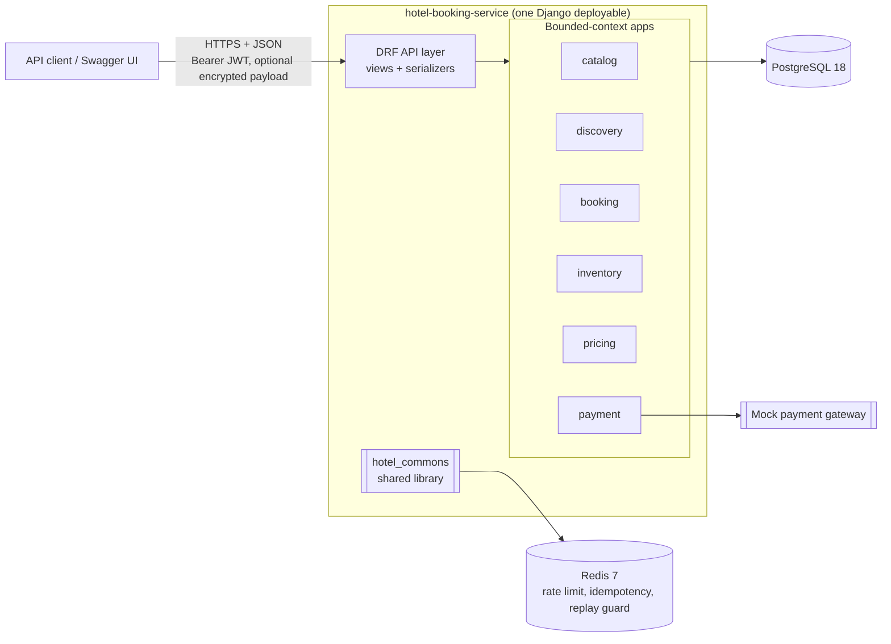

### 3.3 Bounded contexts

| App | Responsibility | Owns (tables) | Public API (`<app>.public`) | Depends on |
|---|---|---|---|---|
| `catalog` | Owner accounts, properties, room types, amenities, commercial settings (pricing strategy, cancellation policy) | owner_account, property, room_type (+ logs), amenity | `CatalogAPI`, events `PropertyOnboarded`, `RoomTypeAdded`, published enums | inventory |
| `inventory` | Per-night allotment per room type; holds | allotment, room_night, hold (+ log) | `InventoryAPI`: provision, extend_horizon, hold, confirm, release, availability, occupancy, occupancy_many (one query for many room types), booking_window | — |
| `pricing` | Nightly prices through pluggable strategies | — | `PricingAPI`: quote, quote_many | inventory, catalog (enums) |
| `discovery` | Search read model and filter pipeline | listing | — (HTTP only) | catalog (events), inventory, pricing |
| `booking` | Booking aggregate, lifecycle, booking types, cancellation policies; orchestrates pay and cancel | booking (+ log) | events only (no other app calls booking) | catalog, pricing, inventory, payment |
| `payment` | Payments, refunds, method strategies, gateway | payment, refund (+ logs) | `PaymentAPI`: find_by_idempotency_key (checks the request fingerprint), charge, refund, get_payment; `PaymentMethodRequestSerializer`, the pay-request body other contexts accept | — |

### 3.4 Context map

Arrows point from the importing app to the `public` package it uses. The graph is acyclic, and an architecture test (`tests/architecture/test_module_boundaries.py`, an AST walk over every import, function-level ones included) fails the build on a cycle, on an app dependency missing from this map, on any cross-app import that bypasses `public`, on a `services/` package importing another app, and on Django or DRF in any `domain/` or `interfaces/` package.

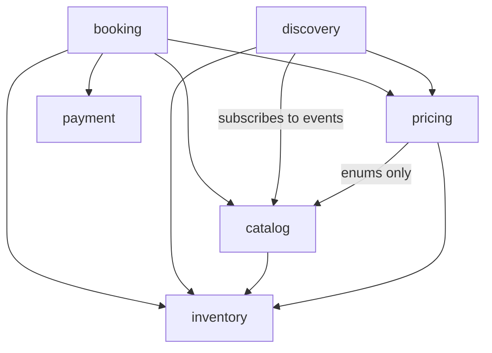

### 3.5 Inside an app

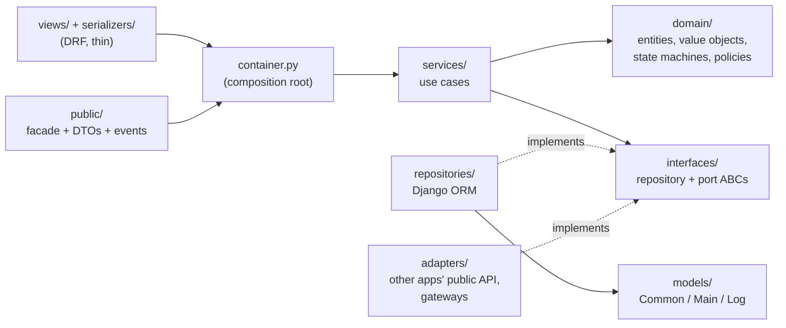

| Layer | May import | Must not import |
|---|---|---|
| `domain/` | stdlib, `hotel_commons.domain`, `hotel_commons.exceptions`, own `enums`/`status_code`, other apps' `public` enums | Django, DRF, models |
| `interfaces/` | own domain | Django, DRF |
| `services/` | own domain, own interfaces, `hotel_commons` (unit of work, events, exceptions) | models, views, other apps |
| `repositories/`, `adapters/` | models, Django, other apps' `public` | views |
| `views/`, `serializers/` | `container`, DRF, `hotel_commons.api` / `security` | models, repositories |
| `public/` | `container`, own DTOs | models |

`container.py` builds each service with Django repositories and in-process adapters. Unit tests build the same services with in-memory repositories and fakes, which proves the persistence and the other contexts are swappable.

## 4. Shared library — `hotel_commons`

An installable package in `libs/hotel-commons` (`pip install -e`), playing the same role as `kuhoo-library`: every app — and every future service — imports base settings, middlewares, model base classes and security primitives from it. It contains nothing hotel-specific.

| Module | Provides |
|---|---|
| `settings.base_settings` | DRF config, middleware order, logging, Postgres (request-path lock and statement timeouts from `DB_LOCK_TIMEOUT_MS` / `DB_STATEMENT_TIMEOUT_MS`) and Redis from env |
| `db` | `DjangoUnitOfWork`, `schema_table()`, the schema-aware PostgreSQL backend (introspection and FK removal understand `schema_table()` names), lock and statement timeouts mapped to retryable errors |
| `models` | `AddCommonField`, the log-model strategy (`CustomUpdateManager.set_logModel`, `add_log_model`), `EnumField`, `EncryptedTextField`, `BlindIndexField` |
| `security` | `Principal` and roles, JWT `TokenService`, PII cipher / blind index / masking, IDOR guard, field-level security, API payload cipher, permissions |
| `middlewares` | request context, JWT authentication, API payload encryption, last-resort exception handling |
| `ratelimit` | `RateLimiter` interface, Redis sliding-window implementation (atomic Lua), DRF throttle |
| `idempotency` | `IdempotencyStore` interface, Redis store, `@idempotent` view decorator |
| `events` | `DomainEvent`, `EventPublisher` interface, in-process bus |
| `domain` | `Money`, `DateRange`, `Clock`, `UnitOfWork`, shared contact rules (`validation`: Indian mobile numbers, email normalisation) |
| `api` | response envelope, DRF exception handler, `BaseViewSet` (OPTIONS answers 405: the contract is the OpenAPI schema), pagination, OpenAPI envelopes (`envelope`, `envelope_list`) |
| `exceptions`, `status_code`, `enum`, `context` | error hierarchy, status-code catalogue, labelled enums, request-scoped context (`ContextVar`) |
| `testing` | fakes (clock, unit of work, event recorder, in-memory stores), token factory |

## 5. Request pipeline

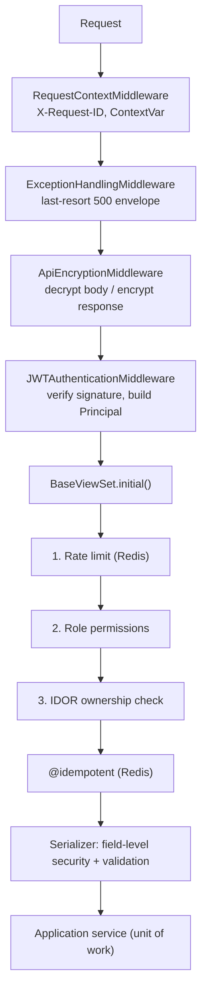

`BaseViewSet.initial()` reorders DRF's default (authenticate → permissions → throttle) to throttle before permissions, so a throttled caller never triggers ownership lookups.

## 6. Key flows

### 6.1 Onboard a property

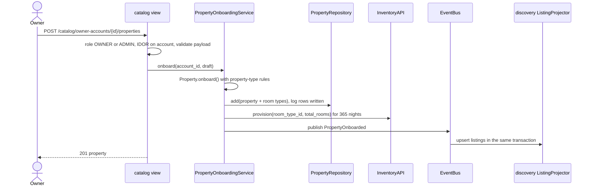

### 6.2 Search

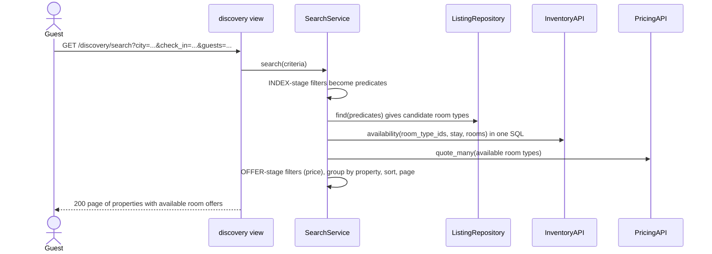

The stay must lie inside inventory's booking window (`[today, today + 365 days]`, 1–30 nights) and amenity codes must exist, else 400: search never lists what cannot be booked. `quote_many` reads occupancy once for every DYNAMIC-priced room type (`InventoryAPI.occupancy_many`), so a search costs one availability query and at most one occupancy query, whatever the number of candidates. A result's `amenities` is the property's own amenities plus those of its room types.

### 6.3 Create a booking (hold)

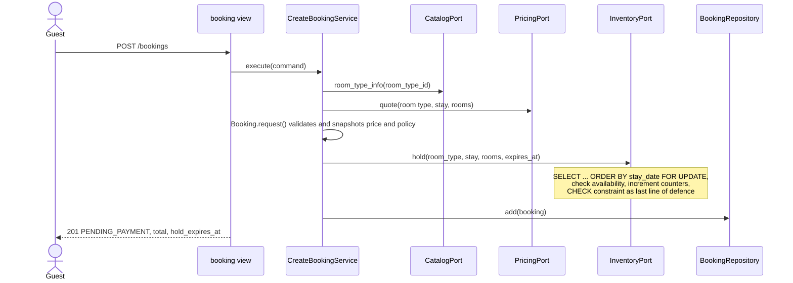

### 6.4 Pay

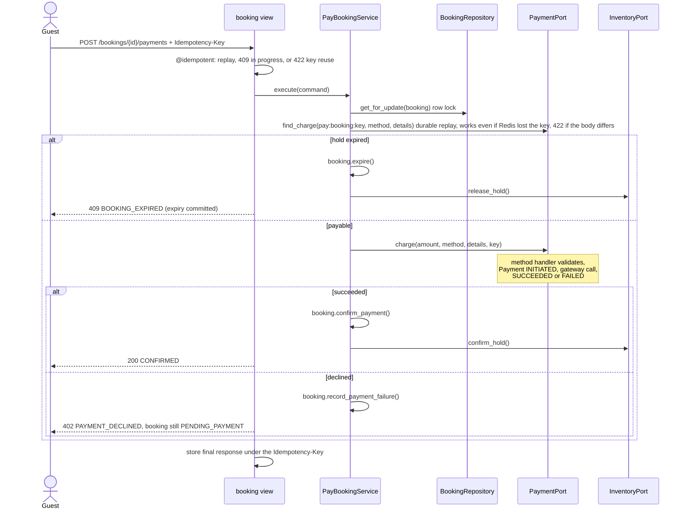

### 6.5 Cancel

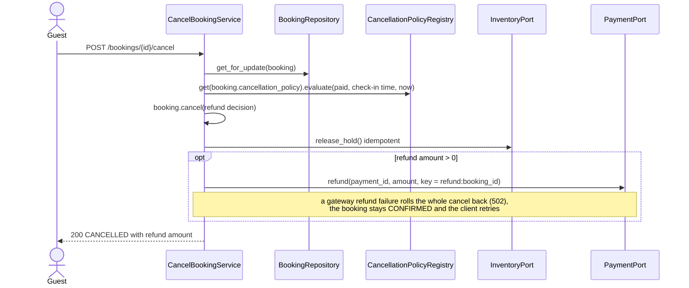

### 6.6 Expire unpaid holds and extend the inventory horizon

A `scheduler` container in docker compose runs two commands every 60 seconds:
- `manage.py expire_pending_bookings` reads the ids of `PENDING_PAYMENT` bookings whose `hold_expires_at <= now`. It then handles each booking in **its own transaction**: lock it with `FOR UPDATE SKIP LOCKED`, expire it, release its hold.
- `manage.py extend_inventory_horizon` keeps per-night rows provisioned up to today + 365 days.

Each run of the expiry job works through batches until one comes back short or its time budget is spent, and never retries in the same run a booking that just failed. The pay flow also expires lazily (§6.4), so booking and payment state never depend on the job's timing: a payment after `hold_expires_at` never charges. Availability does: inventory counts a lapsed hold's rooms as reserved until the job releases them, so they are back on sale within one scheduler interval (about 60 s) of the expiry (trade-off, §15). In production the same commands run from cron or Celery beat.

## 7. Lifecycles

### 7.1 Booking

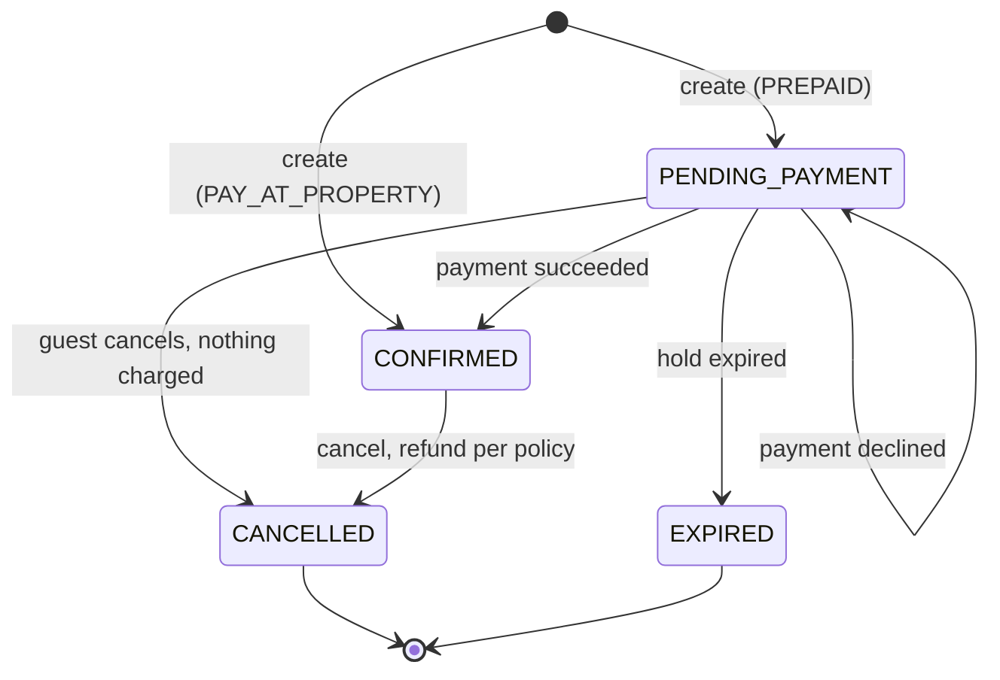

### 7.2 Payment and inventory hold

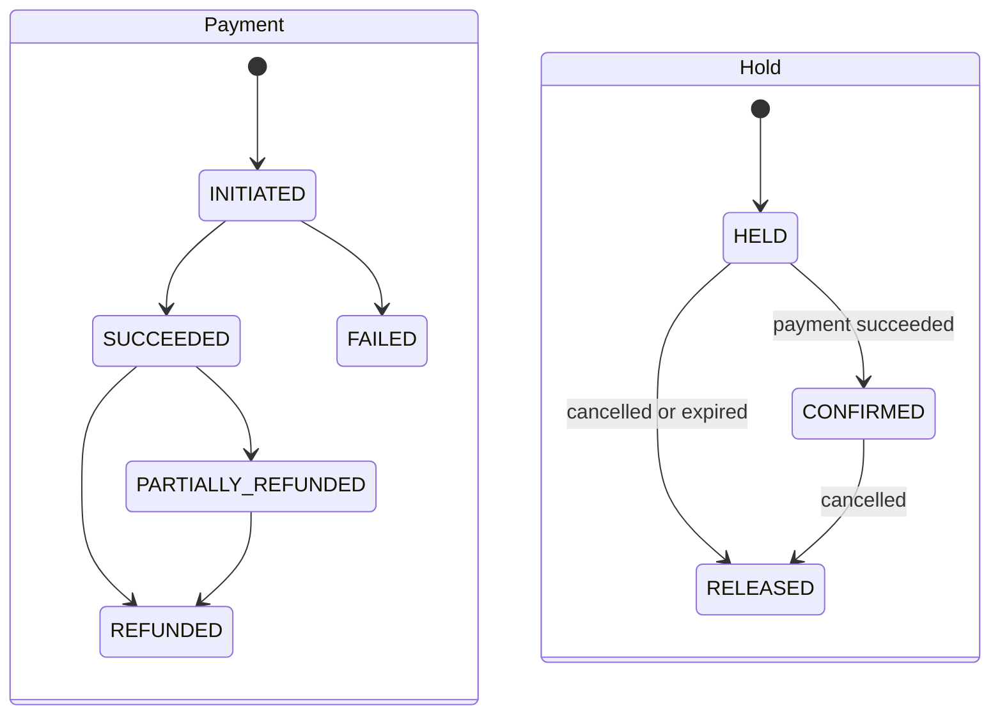

## 8. Data architecture

### 8.1 One database, one schema per context

- **Layout.** One PostgreSQL 18 database with one **schema per bounded context**: `catalog`, `inventory`, `discovery`, `booking`, `payment`. Tables are schema-qualified (`booking.booking`, `payment.refund`); Django internals stay in `public`.
- **Single connection.** Every schema is reached through one connection, so cross-context use cases (book → hold inventory; pay → charge → confirm hold) remain a single ACID transaction. A Django alias per schema was rejected: transactions are per alias, so it would silently create distributed transactions.
- **No foreign keys across schemas.** Cross-context references are UUID columns, so a schema can move to its own database (`pg_dump --schema=…`) when its app becomes a service. Foreign keys inside a schema are normal.
- **Least privilege.** In production each context gets its own database role limited to its schema.
- **Keys.** Primary keys are UUIDv7: time-ordered (good B-tree locality) and unguessable (a second layer against ID enumeration behind IDOR checks).
- **Types.** Money is stored as **BIGINT paisa** (₹ × 100, no floating point anywhere). Enums are **SMALLINT** with a column comment listing their values. Serializers convert both at the API edge: rupee strings and enum names.

### 8.2 Common fields — `AddCommonField`

Every table inherits `status` (1 active, 0 inactive — soft delete), `creation_date`, `creation_by`, `updation_date` and `updation_by`. They are stamped from the caller's principal (read from a `ContextVar`) on every write path — `save()`, queryset `update()`, `bulk_create()`, `bulk_update()` — and fall back to `system` outside a request. `objects_active` returns only active rows.

### 8.3 Log-model strategy (audit trail)

The same triad as the reference services:

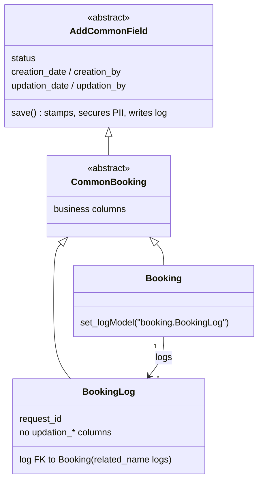

- Every write — `save()`, `update()`, `bulk_create()`, `bulk_update()` — appends a full snapshot to `XLog` in the **same transaction**, with the actor and request id. History is append-only; `log` uses `on_delete=RESTRICT`.
- **Applied to:** OwnerAccount, Property, RoomType, InventoryHold, Booking, Payment, Refund.
- **Not applied to:** RoomNight (a high-churn counter, derivable from holds), Listing (a projection rebuilt from catalog), Amenity (seed data).
- Unique constraints and indexes live on the concrete live model only, so snapshots never collide.

### 8.4 PII encryption at rest

| Data | Table | At rest | Companions |
|---|---|---|---|
| Guest name, email, phone | booking | AES-256-GCM, `ENC_<key-id>:<base64>` | `masked_guest_name`, `masked_guest_email`, `masked_guest_phone` |
| Owner contact email, phone | owner_account | same | `contact_email_hash` (blind index, unique), `masked_contact_email`, `masked_contact_phone` |
| UPI VPA, wallet phone | payment | same | `instrument_display` (masked) |
| Card number, CVV | — | **never stored** (PCI DSS); only brand + last 4 | — |
| Stored idempotent responses | Redis | same cipher | — |

- `EncryptedTextField` encrypts in `get_prep_value` and decrypts in `from_db_value`. Because encryption sits on the field, every write path is covered, log tables included (they reuse the field definitions), and the in-memory instance keeps plaintext.
- A random 96-bit nonce per value; the key id in the prefix allows key rotation.
- The ciphertext is bound to its column with associated data (`<PI type>|<column>`), so it can't be copied into another column. Only the cipher's own `Ciphertext` type skips re-encryption, so user input that looks like ciphertext is still encrypted.
- Equality lookups use a keyed HMAC-SHA256 blind index (`<field>_hash`). The unique index on the owner's contact-email hash blocks duplicate accounts without querying plaintext. Direct lookups on encrypted columns raise an error.
- `masked_<field>` columns are written on every save for reads that must not decrypt (SQL, support and BI tooling). The API decrypts and masks in the serializer for anyone but the subject and ADMIN.
- Commands and DTOs that carry PII or card data hide those fields from `repr`; services log ids only; a logging filter redacts emails, phone numbers and card numbers as a safety net.
- Keys come from env (`PII_ENCRYPTION_KEYS`, `PII_BLIND_INDEX_KEY`), and settings refuse to start with missing or short keys. In production a KMS would supply data keys (envelope encryption).

### 8.5 Redis keyspace

| Purpose | Key | Type / TTL |
|---|---|---|
| Rate limiting | `hb:rl:v1:{scope}:{subject}` | sorted set of request timestamps; TTL = window |
| Idempotency | `hb:idem:v1:{scope}:{principal}:{key}` | encrypted record (state, HMAC fingerprint, response); 60 s in progress, 24 h completed |
| Encrypted-payload replay guard | `hb:enc:v1:{sha256(wrapped key)}` | flag; 2 × clock skew + margin (11 min), so it outlives the whole ±5 min timestamp window |

Redis is never the source of truth:
- If it is down, rate limiting fails open, except for payments, which fail closed.
- Idempotency falls back to Postgres where the key is stored with the write: the payment table's unique key plus a durable replay check in the pay flow (which compares the stored request fingerprint, so a reused key is still 422), so a payment still cannot be charged twice; and booking create's unique `(guest_id, idempotency_key)`, so a retried create returns the first booking. Cancel and catalog writes are best effort while Redis is down.
- IDOR ownership is always read from Postgres (no cache), so it can never be stale.

### 8.6 Scaling the data tier

| Concern | Design |
|---|---|
| Hot inventory rows | One row per room type per night, so contention only arises on the same room type and night. `fillfactor = 80` keeps counter updates HOT; `lock_timeout = 2s` and `statement_timeout = 5s` make contention fail fast with 409/503 instead of queueing |
| Growth | `*_log` tables are append-only with BRIN indexes on `creation_date`, range-partitioned monthly when volume demands, with old partitions detached and archived. `room_night` partitions by `stay_date` |
| Reads | `discovery.listing` is a denormalised read model (GIN on amenities, composite city index), so it can be served from a read replica or replaced by a search engine without touching writers |
| Connections | PgBouncer (transaction pooling) or Django's psycopg pool in production |
| Invariants in the database | CHECK, UNIQUE and partial-index constraints guard counters, dates, amounts and idempotency keys even if application code is wrong |

## 9. Concurrency and consistency

1. **Inventory counters.** `room_night(room_type_id, stay_date, total_rooms, reserved_rooms)` has `CHECK (0 <= reserved_rooms AND reserved_rooms <= total_rooms)`. A hold runs `SELECT … WHERE stay_date in [check_in, check_out) ORDER BY stay_date FOR UPDATE`, checks availability, runs `UPDATE … reserved_rooms = reserved_rooms + n`, and inserts the hold — in one transaction.
   - Locking rows in date order means two overlapping stays can't deadlock.
   - The `CHECK` makes overselling impossible even if application code is wrong.
2. **Booking transitions.** Pay, cancel and expire each lock the booking row first (`SELECT … FOR UPDATE`), so a payment racing the expiry job, or a double-clicked cancel, is decided under the lock. "Expired" means `now >= hold_expires_at`, in code and in SQL alike.
3. **Global lock order.** Night rows are always locked ordered by `(room_type_id, stay_date)`, and a transaction never locks the nights of more than one hold. The expiry job therefore handles one booking per transaction, with `FOR UPDATE SKIP LOCKED`, so workers never block each other and never deadlock against new bookings.
4. **Payment idempotency** is layered:
   - Redis `SET NX` rejects duplicates fast.
   - A durable replay check in the pay flow finds an earlier charge by its key before the status check, so a retried success still returns 200 after Redis forgets the key. The payment row stores an HMAC-SHA256 fingerprint of the method and its details (`IDEMPOTENCY_FINGERPRINT_KEY` over canonical JSON, never raw card data), and a durable replay with a different fingerprint is 422 `IDEMPOTENCY_KEY_REUSED`, as in Redis.
   - A unique `idempotency_key` on payment and refund is the final guarantee. The payment row is inserted before the gateway call, so a concurrent duplicate fails on the insert.
   - The gateway receives the same key.
5. **Booking create idempotency is durable.** A create with an `Idempotency-Key` stores it on the booking under a unique `(guest_id, idempotency_key)`; a retry returns the first booking even without Redis, and a concurrent retry that loses the insert race rolls its own hold back.
6. **Fail fast, retryably.** Request and job connections run with `lock_timeout=2s` and `statement_timeout=5s`. A lock wait that times out (SQLSTATE 55P03) answers 409 `RESOURCE_BUSY`, a cancelled statement (57014) answers 503 `SERVICE_TIMEOUT`, both with `Retry-After: 1` and logged as warnings; the transaction rolls back, so a retry is safe. `migrate` runs with both timeouts off, so a long schema change is not cancelled at deploy.
7. **No missing inventory rows.** A hold first inserts any missing night rows (`ON CONFLICT DO NOTHING`), and a daily job extends the horizon, so a free room is never refused because a row wasn't provisioned yet.
8. **Same-transaction events.** The in-process bus runs handlers inside the writer's transaction, so a catalog row, its inventory rows and its discovery listing commit together.
9. **Outcomes that must persist.** A declined payment or an expired hold is committed first; the service returns an outcome and the view answers 402 or 409. Nothing is rolled back by raising after the state change.
10. **Proof.** Integration tests run real threads against Postgres. Inventory: 10 threads race for the last room (one winner); stays sharing three nights race in both assignments over many rounds, and a hold races an overlapping release, with no deadlock or lock timeout; the lock SQL is pinned to `ORDER BY stay_date FOR UPDATE`, and a negative control proves an opposite lock order is caught. Booking: pay racing the expiry job (one outcome, one charge at most), a double cancel (one refund), two pays with different keys (one charge) and 10 guests booking the last room over HTTP (one 201).

Alternatives considered:
- **Per-physical-room bookings with an exclusion constraint** (`EXCLUDE USING gist (room_id WITH =, stay WITH &&)`, or PostgreSQL 18 `WITHOUT OVERLAPS`). Rejected: guests book room types, not room numbers (A1).
- **Optimistic version columns.** Clients would retry under contention on popular dates.
- **Redis distributed lock.** Adds a second source of truth for something Postgres already guarantees.

## 10. Security architecture

| Concern | Design |
|---|---|
| Identity | HS256-signed JWT (`iss`, `aud`, `exp`, `nbf`, `sub`, `roles`) verified by middleware: algorithm pinned, all claims required, key ≥ 32 bytes, `sub` format checked. A `TokenVerifier` interface allows RS256/JWKS behind an API gateway later. Dev tokens come from `manage.py mint_token`, plus `/dev/tokens`, which exists only when `ENVIRONMENT=local`. The default environment is `production`, and settings refuse missing, short or committed dev keys outside local. |
| Roles | **GUEST:** search, book, pay, cancel own bookings. **OWNER:** create accounts, onboard and manage own properties, list and view bookings of own properties with guest PII masked. **ADMIN:** everything. |
| IDOR | Views declare `idor_rules` per action: resource, where the id is (path, body or query), and which **relationship** counts (`guest`, `owner`). Access needs the matching role *and* relationship. A user who is both guest and owner can view a stranger's booking at their own property but cannot pay for or cancel it. Ownership is resolved from Postgres through resolvers each app registers. A failed check answers **404**, so existence isn't confirmed. List endpoints are always scoped to the caller. |
| Field-level security | Serializers declare `field_policies`. Write-restricted fields return 403 (e.g. `on_behalf_of_user_id` is ADMIN-only). Read-restricted fields are masked or dropped: guest PII is visible only to the guest themself and ADMIN, and masked for everyone else; `gateway_txn_id` is ADMIN-only. |
| API payload encryption | Hybrid RSA-OAEP-256 (3072-bit) + AES-256-GCM. The client encrypts the body with a fresh AES key and sends that key wrapped by the server's RSA public key (`X-Encrypted-Key`) with a timestamp. Associated data binds direction, method, path with its query string, and timestamp, and every method but GET/HEAD/OPTIONS must carry a sealed body. Every encryption uses a fresh nonce. A wrapped key is accepted once (Redis replay guard, kept for the whole timestamp window). The response is encrypted with the same AES key. Modes: `off`, `optional` (local default), `enforced`, with an exact-path bypass list (health, docs, schema, public key, dev tokens). |
| Rate limiting | Sliding-window log in Redis, run as one atomic Lua script using Redis server time. Per-scope policies (default 120/min, search 60/min, booking writes 20/min, payments 10/min) keyed by principal, or by client IP when anonymous. The client IP comes from `REMOTE_ADDR`, or from a configured number of trusted proxy hops, so spoofed `X-Forwarded-For` values can't mint fresh buckets. Returns `429` with `Retry-After` and `X-RateLimit-*` headers. Fails open if Redis is down, except payments, which fail closed. Encrypted requests are also IP-limited before any RSA work. |
| PII at rest | §8.4 |
| Audit | Log-model rows record who changed what, when, and in which request. |

## 11. Extensibility

| To add | Change | Untouched |
|---|---|---|
| A search filter | New `SearchFilter` class, decorated with `@register_filter` | `SearchService`, view |
| A payment method | New `PaymentMethodHandler` + enum member | `ChargeService`, booking |
| A pricing strategy | New `PricingStrategy` + `PricingStrategyCode` member | quote engine, discovery, booking |
| A cancellation policy | New `CancellationPolicy` (or a new tier table) + enum member | `CancelBookingService` |
| A booking type | New `BookingTypePolicy` + enum member | booking services |
| A property type | `PropertyType` member, optional `PropertyTypeRule` | onboarding service |
| A real payment gateway | New `PaymentGateway` adapter wired in the container | payment domain and services |
| Different persistence | New repository implementations wired in the container | services, domain |
| A message broker | New `EventPublisher` (outbox + Kafka/RabbitMQ) | publishers, handlers |

## 12. API conventions and errors

- Base path `/hotel/{API_VERSION}/` (default `v1`), JSON only, no trailing slashes. OpenAPI schema at `/hotel/v1/schema`, Swagger UI at `/hotel/v1/docs`.
- Success envelope: `{"status": 2100000, "message": "Success", "data": {...}, "request_id": "..."}`. Error envelope: `{"status": 2105002, "message": "...", "errors": {...}, "data": null, "request_id": "..."}`. Real HTTP status codes are always used.
- Outcome responses keep `data`: a declined payment (402) and an expired hold (409) return the current booking in `data`, because the state change was committed.
- Custom serializer fields (`Hotel*Field`, like the reference `Kuhoo*Field`s) own every conversion and carry field-level access rules (`restrict_roles`, `read_roles`, `mask_as`).
  - Amounts travel as rupee strings (`"9600.00"`) with a sibling `currency`, and are stored as integer paisa.
  - Enums travel as names (`"PREPAID"`) and are stored as SMALLINT.
- Status codes follow `SS MM EEE`: service `21`, module (`00` common, `01` catalog, `02` inventory, `03` pricing, `04` discovery, `05` booking, `06` payment), error number. Each app keeps its catalogue in `status_code.py`, as in the reference services.
- HTTP mapping: 400 validation (search included: a stay outside the booking window, a bad date order or length, an unknown amenity code) · 401 token · 402 payment declined · 403 role or field · 404 not found or not yours · 405 method not allowed (OPTIONS included) · 409 state conflict, no inventory, idempotent request in progress, resource busy (lock timeout, `Retry-After`) · 422 business rule or idempotency-key reuse · 429 rate limit · 500 unexpected · 503 statement timeout (`Retry-After`) or health check failing.
- The OpenAPI document is generated by drf-spectacular and checked by a contract test: it validates with no generator warnings, write operations declare `Idempotency-Key`, and real responses of a full booking journey (errors included) validate against their documented schemas.

## 13. Deployment and configuration

- `docker compose up --build` starts `postgres:18`, `redis:7`, the app (gunicorn) and the scheduler (§6.6). Migrations (with the request-path DB timeouts off) and demo data (a chain owner with two properties and a standalone owner with one) run on start, so search works immediately.
- Every published port is bound to `127.0.0.1`; the API's host port is `APP_PORT` (default 8000).
- gunicorn's access log records the path without the query string (it bypasses the PII redaction filter, and query parameters such as `guest_id` may carry an email), plus status, size, duration and request id.
- Configuration is all environment variables. `.env.example` holds clearly labelled dev-only keys so compose works out of the box; settings refuse those keys unless `ENVIRONMENT=local`. `scripts/bootstrap_env.py` writes a fresh local `.env` with random keys and a new RSA-3072 key under `secrets/local/` (mounted read-only), and refuses to overwrite either without `--force`.
- `GET /hotel/v1/health` checks Postgres and Redis.

## 14. Path to microservices

1. Each app becomes a service with its own database; there are no cross-app foreign keys to untangle.
2. In-process adapters (`booking/adapters/*`, `discovery/adapters/*`, …) are replaced by HTTP or gRPC clients implementing the same port interfaces. Domain and services don't change.
3. The in-process event bus is replaced by a transactional outbox and a broker. Discovery becomes eventually consistent, with a search-engine read model.
4. Pay and cancel become sagas with compensations: refund if confirmation fails, release on timeout.
5. `hotel_commons` is published to a private package index and versioned. JWTs are verified at the gateway and in each service (RS256/JWKS).

## 15. Trade-offs and future work

- **Gateway call inside the booking transaction.** The charge (pay) and the refund (cancel) run inside the booking's unit of work, under its row lock and, on cancel, the stay's night locks. Simple and atomic with the in-process mock: a failed refund rolls the whole cancel back. With a real gateway the locks are held for the network round trip, and a rollback after a successful call leaves no local trace of the money moved. Then: commit an INITIATED payment or refund in its own short transaction, call out without locks, settle through a webhook or outbox, and reconcile INITIATED rows.
- **Expired holds return to sale on the next scheduler run.** Inventory does not reclaim a lapsed hold itself, so its rooms stay reserved for up to one scheduler interval (about 60 s) after `hold_expires_at`; booking and payment state are unaffected (§6.6). Releasing lapsed holds inside `hold()` would close the gap.
- **Search computes availability and price per request.** Fine at this scale. At scale: precomputed availability, cached quotes, a search engine.
- **Synchronous in-process events** trade decoupling for atomicity inside the monolith.
- **Future work:** per-channel rate plans and inventory, partial cancellation, notifications, an outbox, OpenTelemetry tracing (as in the reference service), admin tooling.
